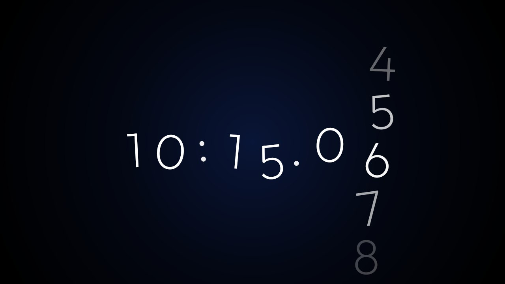

# Floating Clock

  

  <a href="https://shirui-liu.github.io/floating-clock/"><strong>▶ Live Fullscreen Web Demo</strong></a>
  &nbsp;·&nbsp;
  <a href="https://github.com/Gathin23/cleanyourtv/pull/4244"><strong>Android TV Add-on (CleanYourTV)</strong></a>

A minimalist floating `HH:mm.ss` digital clock over a subtle, slow-shifting ambient glow — available both as a **zero-dependency Web Canvas demo** and an **offline Android TV screensaver (`DreamService`) & CleanYourTV module card**.

## Design Highlights
- **Weightless floating digits**: The first five digits (`HH:mm.S₁`) and separators float gently in place in pure-white `Outfit` ExtraLight with staggered offsets and soft tilt.
- **Unhurried 3.2 s carry float**: Only across a carry (±1.6 s) does the incoming digit drift lazily up from below while the outgoing digit floats away and fades out.
- **Continuous second stream**: Only the last second digit (`S₂`) flows continuously upward in a gentle swaying S-wave with a soft vertical alpha fade.
- **Burn-in friendly**: Slow continuous Lissajous drift around center over a subtle low-brightness radial ambient glow.

## Real Android TV Preview

## Run Locally
Just open `index.html` in any modern browser (click anywhere or press `F` for fullscreen).
